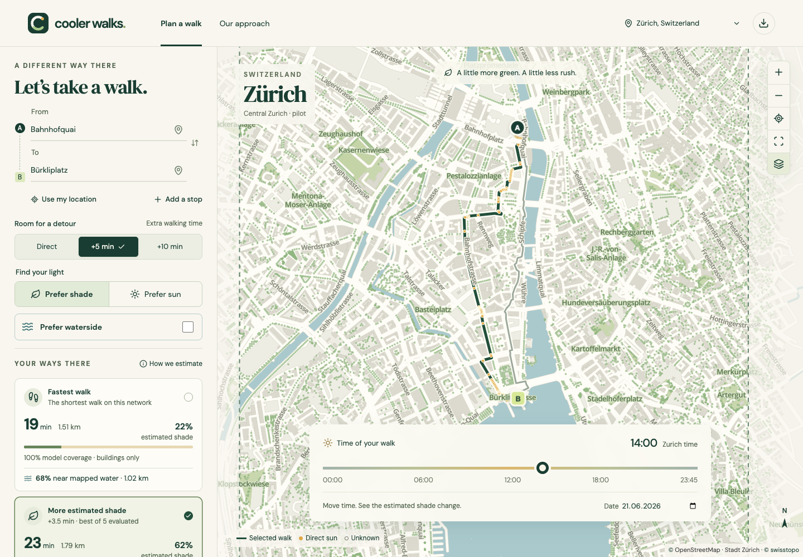
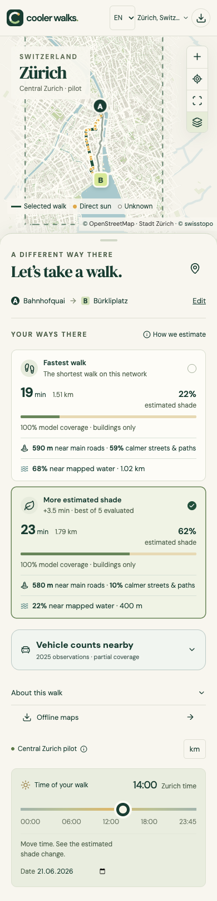

# Cooler Walks

Compare walking routes by estimated shade, greenery, nearby water and calmer streets.

[Deutsch](README.de.md) · English / German website and app interface

**Validation status:** traffic-model development continues; shadow and traffic will be field-validated later. Both remain experimental. Shadow roof-source discrepancies and dated observations are still unresolved; the requested 3D-library expansion remains experimental and does not clear the field-validation hold. [Audit results](docs/shadow-validation.md).

The [latest evidence review](docs/shadow-validation-followup.md) checks all 26 flagged roof samples against raw LiDAR and screens 14 photo originals and their timestamps. Three photos remain promising; an exploratory Münsterhof mismatch is retained for investigation. This does not establish field accuracy.

**Status:** **Zurich is the primary focus**, with an expanded 57.77 km² walking area and official address search. **Basel, Munich and Cambridge (Massachusetts) are beta**. Cambridge follows its municipal boundary; the other cities cover central areas. These remain experimental services, not field-validated citywide routing. Zurich and Munich estimate building sun/shade; Cambridge and Basel offer greenery and water proximity only. Paris remains under review. Tree shade, hill shadows, weather, live closures and navigation are not included.

**Pavement expansion 0.15.0:** 25,740 official pavement, footpath and crossing sections across the current 57.77 km² Zurich map, with junction search and direct map selection. Shade uses the existing 3D model; uncertain bridge/underpass heights stay unknown. [Open the pilot](https://coolerwalks.ch/?view=planner&network=pavements) · [source, checks and limits](docs/pavement-pilot.md). Field validation remains pending.

**3D library 0.13.0:** the whole supported Zurich walking area now uses detailed roofs and ground elevations. [Expansion and checks](docs/shade-library.md).

**Interface 0.12.0:** simpler English/German copy, compact route cards, and departure controls above phone results. The website and native apps share the same interface. [Design notes](docs/design.md#plain-language-and-simpler-layouts--0120).

**Traffic 0.11.0:** clearer street categories, absolute-distance comparisons, and historical counters selected for estimated passing time. [Method and field plan](docs/traffic.md).

**German version:** [coolerwalks.ch/de/](https://coolerwalks.ch/de/) · switch EN/DE without losing your trip.

**Live website:** [coolerwalks.ch](https://coolerwalks.ch/) · [Open the planner](https://coolerwalks.ch/?view=planner)

## Run locally

Requires Node.js 22.12+ and npm. No API keys or accounts are needed. Browser downloads work on the same origin; native remote downloads use the optional setting in `.env.example`.

```sh
npm ci
npm run dev
```

Open **http://127.0.0.1:5173/** for the entry page or **http://127.0.0.1:5173/?view=planner** for the planner. A returning browser opens the planner directly. Processed regional extracts are included, so a fresh checkout does not need to download the raw data. They total about 207 MB before compression; the browser loads one city at a time.

For the installable production build:

```sh
npm run build
npm run preview -- --port 4173
```

Open **http://127.0.0.1:4173/**. Localhost is a secure context for PWA development. Production hosting must use HTTPS and serve `dist/`, including the real `/privacy/` and `/support/` pages. Missing data/pack URLs must return 404, never the app HTML. Optional Sites hosting configuration is in `.openai/hosting.json`; no external Site has been registered.

## Domain, hosting and store preparation

**Launched on Netlify:** the website and its five map packs are public. `coolerwalks.ch` is registered with Infomaniak; the apex A record and `www` CNAME point to Netlify. The existing Free Legacy hosting plan is unchanged. The support contact is `knoerzerjohannes@protonmail.com`. Durable retention of native map downloads remains a prerequisite for store distribution.

```sh
npm run release:prepare         # checked website archive, matching packs and SHA-256 manifest
npm run release:serve           # preview with production-style headers at port 4181
npm run test:release:browser    # privacy/help accessibility, CSP and offline checks
```

The upload files are in ignored `release-artifacts/`. `release/site.json` now contains the public domain, contact and Netlify privacy details. Netlify automatically builds `main` using `netlify.toml`; the manual GitHub release-preparation workflow creates private artifacts only. See [domain/DNS and hosting instructions](docs/hosting.md), [Android/iOS store instructions](docs/app-stores.md) and [listing copy](release/store-listing.json). No store enrollment or submission has been made.

## What works

- **Zurich vehicle-count evidence:** 144 directional counters at 80 pilot sites. View 2025 weekday/hour averages near the selected route, measured-day completeness and numbered map markers. Counts are historical and sparse; they do not replace street-context ranking or imply zero traffic elsewhere. [Sources and preparation](docs/vehicle-counts.md).

- **Tempo 30 / 20 layer:** use the **30/20** map button in Zurich. Solid outlines show implemented city zones; dashed outlines show nearby cantonal orders with unknown implementation. Tap a zone for its name and status. Included in updated offline maps. [Sources and preparation](docs/data-sources.md#tempo-30--20-map-layer--6-october-2026).
- **Prefer calmer streets / Verkehrsberuhigt bevorzugen** in Zurich: current official pedestrian, Begegnungszone and Tempo-30 zones plus mapped main-road proximity. Reduces distance near main roads first, within the same detour limit. No live traffic counts, noise or safety rating. See [sources, model and real route result](docs/traffic.md).
- Full **English / German** interface, including source explanations, errors, downloads, static privacy/help and PWA metadata. Language changes preserve the current trip. [Localization guide](docs/localization.md).

- A locally rendered MapLibre map of actual OSM streets, buildings, water and parks; a visible coverage boundary, muted unsupported surroundings, “Show whole coverage” control and source attribution. Coverage is now 57.77 km² in Zurich, 8.90 km² in Munich, 18.46 km² in Cambridge and 10.25 km² in Basel; [the coverage report](docs/coverage-validation.json) checks routes beyond the previous pilots.
- Offline search across 56,704 real official Zurich addresses, including 45,795 inside the walking area, plus local streets and places. Enter a street/house number and optional postcode, or tap the map to choose a start, destination or stop. Outside-area addresses are labelled and cannot produce routes. Address points locate buildings, not verified entrances. [Source, coverage and preparation](docs/zurich-north-west.md).
- Fastest graph route and genuinely different alternatives within 0, 5 or 10 extra minutes; 5 minutes is the default.
- Up to three ordered stops, with search/map selection, reordering, removal and trip reversal. The extra-time budget applies to the whole trip through all stops; dwell time is excluded.
- Optional **Prefer waterside** routing and a separate measure of distance within 50 m of mapped surface water. Proximity does not establish views, bank access, drinking water or cooling.
- **Prefer shade / Prefer sun** in Zurich and Munich, including winter dates. Uses actual Swiss or Bavarian building geometry and solar position, sampled at most every 8 m at the expected arrival instant. Unknown coverage cannot count as sunshine. Greenery remains a separate 15 m tree-proximity measure.
- Four city configurations with local sources, metric coordinate systems, coverage and IANA time zones. Cambridge uses America/New_York, independently of the device’s zone. Local date/time rejects ambiguous or skipped DST times. Metric/imperial display, a responsive phone sheet and source/coverage views are shared.
- PWA icons, manifest and installation guidance. The interface installs separately; city bundles are cached when visited. Zurich now caches 3D tiles as needed; download the full area for complete offline planning. Source data stays dated; no live updates are implied.

Use Bahnhofquai → Bürkliplatz on **21 June 2026**, compare **10:00, 14:00 and 18:00 Europe/Zurich**. The exact computed validation results are stored in [docs/route-validation.json](docs/route-validation.json). At 10:00 and 18:00, the current uncertainty checks withhold the shade comparison and show greenery; the 14:00 shade/sun comparison is supported. No examples use synthetic production routes.

For vehicle counts, use the same trip on **Monday 22 June 2026 at 14:00**, select **Fastest walk**, then open **Vehicle counts nearby**. Its three directional measuring points show rounded historical means of 310, 1,220 and 360 vehicles/hour for Mondays at 14:00 in 2025. The calmer alternative has no supported nearby counter; its vehicle volume is unknown.

- **Offline maps** manager: versioned, checksum-verified downloads with progress, cancellation, removal and offline reopening. Four larger pilot packs plus a compact 2 km² Munich Old Town pack. Browser IndexedDB and private native filesystem storage share the same format. See [download setup and limitations](docs/downloads.md).

## Native iOS and Android apps

The same planner now has native Capacitor projects, in addition to the browser/PWA. Native builds include all four map/data bundles, open directly in the planner, use native location permission on request, and handle safe areas and Android Back. They are development builds, not App Store or Google Play releases.

```sh
npm run native:sync          # build shared assets and sync both native projects
npm run native:android       # Android SDK 36 + Java 21; creates a debug APK
npm run native:open:android  # open Android Studio
npm run native:ios           # macOS + Xcode 26+ + installed iOS simulator platform
npm run native:open:ios      # open Xcode
```

Detailed setup, signing boundaries and offline behaviour are in [docs/mobile.md](docs/mobile.md). Actual platform test results are in [docs/platform.md](docs/platform.md). Signing credentials and generated native build outputs are ignored.

Android **0.14.1/build 13** includes faster Zurich calculations and cancellation when trip inputs change. Its test APK is available locally as `native-artifacts/cooler-walks-0.14.1-debug.apk`. The website/PWA also handles cached-data updates automatically. The previously failing cold autumn-afternoon route now loads in about 20 seconds on the 2 GB Android 16 emulator, with the original 60-second check unchanged. [Current platform evidence](docs/platform.md#maintenance-release--0141) · [CI and cache maintenance](docs/maintenance.md).

The previous Android **0.13.0/build 11** compiled and passed offline traffic-v2 comparison, passing-time counts, 3D-roof shade, address-search/routing, German and beta city-switch checks in the 2 GB Android 16 emulator. Its debug APK is available locally as `native-artifacts/cooler-walks-0.13.0-debug.apk`. The earlier 0.5.0 build passed twelve broader checks covering native permissions, Back/resume, all four cities offline and cold launch. iOS 0.13.0 also compiles and archives in GitHub Actions; the previous 0.5.0 build launched in English and German on the local iPhone 16e simulator. iOS count interactions and physical phones remain untested; neither app has been submitted to a store.

## Develop and verify

```sh
npm run check          # TypeScript and focused model tests
npm run data:verify    # real pairs in every pilot, sun/shade, water and detours
npm run build         # production build and offline cache manifest
npx playwright install chromium
npm run test:e2e       # real browser interactions and responsive screenshots
npm run format:check  # consistent source and documentation formatting
```

To use an existing Chrome executable for tests, set `PLAYWRIGHT_CHROMIUM_EXECUTABLE` to its absolute path. On macOS this can be `/Applications/Google Chrome.app/Contents/MacOS/Google Chrome`. Browser tests run in an isolated profile. The test runner starts a local development server if needed. GitHub Actions runs the checks, build and browser tests on pushes and pull requests.

With the production preview running, `PWA_HEADFUL=1 npm run test:pwa` verifies offline reload, installation and a standalone launch in an isolated visible Chrome window. It uninstalls its test app afterwards. See [platform verification](docs/platform.md) for the tested macOS Chrome path and untested mobile platforms.

## Architecture

| Area                                                               | Location                                |
| ------------------------------------------------------------------ | --------------------------------------- |
| City identity, CRS, time zone, coverage, versions and capabilities | `src/lib/cities.ts`                     |
| Graph routing, candidate generation, coverage and exposure scoring | `src/lib/routing.ts`                    |
| Solar, projection and local-time functions                         | `src/lib/solar.ts`, `geo.ts`, `time.ts` |
| Background calculations, stale-response suppression                | `src/route-worker.ts`, `src/App.tsx`    |
| Cartography and local place search                                 | `src/components/`                       |
| Reproducible ingestion, geometry extraction and verification       | `scripts/`                              |
| Derived runtime data                                               | `public/data/`                          |
| Untracked source downloads                                         | `data/raw/`                             |

The browser makes no third-party search, route, tile or font requests. Your precise journey is not saved. City, selected area, language, units, the returning-user preference and explicit map downloads are stored locally. An optional native data host receives requests for public area files, never journey inputs. Geolocation is requested on demand; the browser's own location provider may contact external services.

## Data and limitations

Read [data sources and preparation](docs/data-sources.md), [the model](docs/model.md), [city coverage](docs/cities.md), [design](docs/design.md), [platform checks](docs/platform.md), and [roadmap](docs/roadmap.md).

Version **0.13.0** extends actual 3D roofs/facades and LiDAR ground elevations across **all 57.77 km² of the supported Zurich walking area**, about 17.2× the original detailed pilot. An 81-tile library includes 41,042 buildings and surrounding shadow casters. Online trips load only needed tiles; the complete Zurich offline pack is 80.2 MB. [Data, architecture and validation](docs/shade-library.md). Route cards distinguish geographic 3D coverage from classified sun/shade coverage. This refines roof shape and receiver elevation; tree and distant hill shadows remain excluded. [Method, sources and reproducible preparation](docs/detailed-shade.md). Centreline geometry does not establish which pavement is shaded. The model is not field-validated and provides no measured temperature or comfort benefit.

Version **0.9.0** evaluates shadows at the expected arrival at every route sample (at most 8 m apart), using each alternative's own walking time and every leg through ordered stops. Cards show estimated arrival times in the city’s zone. Walks crossing low sun or night have a separate explanation; darkness cannot improve a shade recommendation. Walking speed remains 4.8 km/h without pauses or crossing waits. [Method and computed comparisons](docs/arrival-shade-validation.json).

The walking extract follows recorded pedestrian access and shared OSM node topology. It does not know current closures, crossing waits or unrecorded access changes. It is not an accessibility or turn-by-turn navigation service. Below 10° solar elevation and outside adequate source coverage, the interface uses greenery rather than an unsupported shade recommendation.

The [Zurich tree-position audit](docs/tree-accuracy.md) checks import fidelity and compares older register IDs with a fresh municipal sample. Munich trees are automatically detected positions, with documented false-positive risks; Cambridge and Basel use municipal registers. Sun/shade percentages remain **buildings only**. Sun preference is manual in every season. Low winter sun and tile-edge coverage can prevent a comparison; this is shown explicitly.

Real route checks for every pilot are in [city-route-validation.json](docs/city-route-validation.json), with expanded-area journeys in [coverage-validation.json](docs/coverage-validation.json). Use the selected city’s default trip on **21 June 2026 at 14:00 local time** as a repeatable starting point. Cambridge’s missing building heights and Basel’s unintegrated height layer are documented in [the coverage register](docs/cities.md).

## Screenshots

3D library 0.13.0: [Oerlikon desktop](docs/screenshots/desktop-3d-oerlikon.png), [German phone](docs/screenshots/phone-3d-oerlikon-de.png), [Android offline](docs/screenshots/android-3d-oerlikon.png), and [coverage](docs/screenshots/desktop-zurich-coverage.png).

Interface 0.12.0: [desktop entry](docs/screenshots/desktop-lean-entry.png), [German entry](docs/screenshots/desktop-lean-de.png), [phone planner](docs/screenshots/phone-lean-planner.png) and [Android app](docs/screenshots/android-lean-planner.png).

Traffic 0.11.0: [desktop](docs/screenshots/desktop-traffic-v2.png), [German phone](docs/screenshots/phone-traffic-v2.png) and [tablet street breakdown](docs/screenshots/tablet-traffic-v2.png).

The 0.10.0 detailed model: [desktop](docs/screenshots/desktop-3d-shade.png), [German phone](docs/screenshots/phone-3d-shade.png) and [tablet explanation](docs/screenshots/tablet-3d-method.png).

Shadow timing in 0.9.0: [desktop](docs/screenshots/desktop-arrival-shade.png), [German phone](docs/screenshots/phone-arrival-shade.png) and [low-sun transition](docs/screenshots/tablet-changing-light.png).

Expanded coverage: [Whole Zurich coverage](docs/screenshots/desktop-zurich-coverage.png), [Altstetten on desktop](docs/screenshots/desktop-zurich-addresses.png), [German phone search](docs/screenshots/phone-zurich-search.png), [expanded-area walk](docs/screenshots/phone-zurich-expanded.png) and [outside-area state](docs/screenshots/tablet-zurich-outside.png), [installed map selection](docs/screenshots/installed-map-selection.png) and [Android address planning](docs/screenshots/android-zurich-addresses.png).

Vehicle-count views: [Vehicle counts on desktop](docs/screenshots/desktop-vehicle-counts.png), [German phone](docs/screenshots/phone-vehicle-counts.png), [missing observations](docs/screenshots/tablet-counts-unavailable.png), [Android counts](docs/screenshots/android-vehicle-counts.png) and [installed PWA counts](docs/screenshots/installed-vehicle-counts.png).

German interface views: [German desktop comparison](docs/screenshots/desktop-german-calm.png), [German phone](docs/screenshots/phone-german-calm.png), [German entry](docs/screenshots/desktop-german-home.png), [recoverable error state](docs/screenshots/tablet-german-error.png), [installed German PWA](docs/screenshots/installed-german-app.png), [Android calmer route](docs/screenshots/android-german-calm.png) and [German iOS launch](docs/screenshots/ios-v050-german.png).

Actual browser, Android emulator and iOS simulator captures are in [docs/screenshots](docs/screenshots), including [expanded Cambridge on desktop](docs/screenshots/desktop-expanded-cambridge.png) and [offline Munich in the native app](docs/screenshots/android-offline-munich.png). The [download manager](docs/screenshots/desktop-downloads.png) and [compact Munich phone view](docs/screenshots/phone-downloaded-area.png) show the new flow. They document visual review, not physical-device or field validation.





## Licensing

Code: [MIT](LICENSE). Geographic data retains its source licences; see [public/data/README.md](public/data/README.md). In particular OSM-derived data is subject to ODbL, rather than the code licence. Fonts retain their respective open font licences. Keep attribution visible when reusing or deploying the app.
