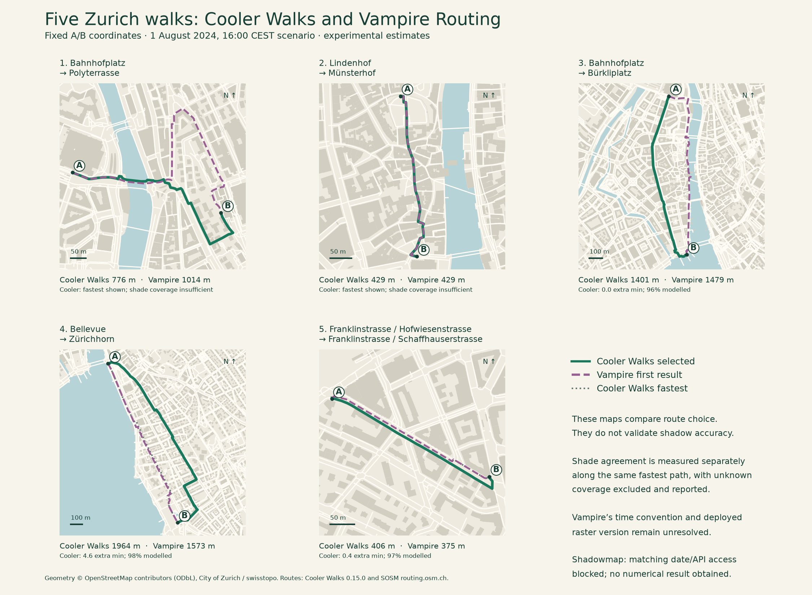
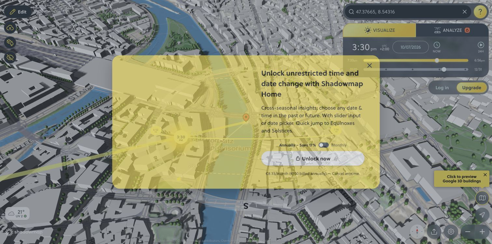

# Five Zurich walks compared with Vampire Routing and Shadowmap

The results below freeze the building-only model before the optional [lakeshore canopy scenario](tree-shade-pilot.md). They have not been replaced or presented as validation of that new scenario.

Checked **7 October 2026**, using Cooler Walks **0.15.0**. This is a diagnostic comparison between models, **not a field-accuracy validation**. No production model, recommendation threshold or source geometry was changed to improve agreement. The existing field-validation hold remains.

Five A/B pairs were fixed before collecting the results: ETH hill/river crossing, dense old town, Bahnhofstrasse, treed lakeshore, and Oerlikon. These are deliberately varied examples, not a random or representative city sample. Exact WGS84 endpoints are in the [protocol](../scripts/shade-service-cases.json).

## What each service actually returned

The [SOSM Vampire demonstration](https://sosm.ch/de/die-coolste-art-schattige-wege-zu-finden-vampir-routing-auf-routing-osm-ch/) uses a fixed 1 August, 16:00 shadow scenario. Its author's [GeoBeer presentation](https://geobeer.ch/slides/46/lightning-talks.pdf) specifies 2024. We ran our primary scenario at **2024-08-01 16:00 Europe/Zurich = 14:00 UTC**, with five extra minutes allowed and waterside/calmer-street preferences off. The regular OSM walking network is used to reduce confounding with the municipal pavement pilot. This does not imply identical OSM extracts or edge geometry.

The table uses the **first returned Vampire route**, alongside the separate SOSM ordinary walking result. For this shade-focused comparison, our selected route is the qualifying shade alternative when available; otherwise we show the fastest route. In two cases insufficient model coverage prevents a shade recommendation. The ETH case also returns a **982 m greener alternative**, retained in the recorded outputs; the app can select that greenery option, but it is not a shade recommendation. The old-town case returns no alternative.

| A → B                                                      | Cooler fastest | Cooler selected | SOSM ordinary foot | Vampire | Cooler selection                         |
| ---------------------------------------------------------- | -------------: | --------------: | -----------------: | ------: | ---------------------------------------- |
| Bahnhofplatz → Polyterrasse                                |          776 m |           776 m |              781 m | 1,014 m | Fastest; insufficient shade coverage     |
| Lindenhof → Münsterhof                                     |          429 m |           429 m |              429 m |   429 m | Fastest; insufficient shade coverage     |
| Bahnhofplatz → Bürkliplatz                                 |        1,401 m |         1,401 m |            1,400 m | 1,479 m | Fastest; no qualifying shade alternative |
| Bellevue → Zürichhorn                                      |        1,594 m |         1,964 m |            1,607 m | 1,573 m | More estimated building shade, +4.6 min  |
| Franklin-/Hofwiesenstrasse → Franklin-/Schaffhauserstrasse |          375 m |           406 m |              376 m |   375 m | More estimated building shade, +0.4 min  |



Native Cooler arrival-time diagnostics on the selected routes are respectively **7%, 49%, 67%, 56%, 80% shade over modelled distance**, with **84%, 94%, 96%, 98%, 97% of total distance modelled**. The first two figures are diagnostic values, not shade recommendations displayed by the app. Known bridge/non-ground sections remain unknown. Native calculations use the original at-most-8 m samples and the expected arrival at each sample, at 80 m/min.

Vampire returned route geometry, distance and duration, **not a route shade percentage**. The ten small public OSRM responses (five pairs × two profiles) were fetched once and retained with timestamps and SHA-256 hashes. [Recorded external outputs](validation/shade-services/external-routes.json) · [Cooler outputs](validation/shade-services/cooler-routes.json). No API data-version field was returned. The optional alternatives are retained but not cherry-picked.

Endpoint checks: both services received the same fixed coordinates. Cooler snapped at most 2.0 m and Vampire at most 1.9 m. The Vampire text-search UI initially replaced coordinates with nearby geocoding results; that exploratory request is excluded. The benchmark uses coordinates directly in the documented OSRM request and visible permalink, with actual snapped coordinates retained. Oerlikon’s returned Vampire polyline starts 0.79 m from its own reported snapped waypoint; both are preserved, with no silent geometry correction.

Time displays are not directly comparable. Cooler uses 4.8 km/h; SOSM's public frontend configures 4.5 km/h for ordinary foot and 4 km/h after choosing the Vampire profile. We also observed a direct Vampire permalink initially displaying the raw API duration until a profile selection. For the 1,014 m ETH route this was 12 min initially versus 15 min after selecting Vampire. Consequently the table compares distances; extra walking time above uses Cooler's own 80 m/min assumption. API duration is preserved separately and is never treated as sunlight exposure.

## Shade on exactly the same path

To isolate model disagreement from route choice, we sampled **our fastest route for each pair**, at intervals of at most **4 m**, using the same positions in both models. There are **1,346 midpoint samples across 4.575 km**. We evaluated our production geometry at the departure instant, retaining non-ground masks, and sampled the pinned public Vampire raster using its ASC georeferencing and the author's `<100` shade proxy. This snapshot comparison is deliberately separate from the app's arrival-time calculation.

The public raster does **not** establish which raster/build is deployed on the live routing service. These raster percentages are **our offline calculations on the author's published artifact**, not values returned by the Vampire website. The raster channel and clock convention are also missing. [Pinned source](https://github.com/sosm/cbf-routing-profiles/tree/6b45390967718a4b785af11222fd0dc2688eeeac/vampire).

All percentages in this table use the **same, mutually modelled walking distance** within each row. Unknown distance is excluded from both shade fractions and from agreement, and shown through the comparable coverage column. Values are rounded; unrounded metre totals and all samples are retained.

| Fixed fastest path          | Cooler shade, 16:00 CEST | Published Vampire raster shade | Sun/shade agreement | Comparable route coverage |
| --------------------------- | -----------------------: | -----------------------------: | ------------------: | ------------------------: |
| Bahnhofplatz → Polyterrasse |                       8% |                            26% |                 79% |                       84% |
| Lindenhof → Münsterhof      |                      49% |                            81% |                 65% |                       95% |
| Bahnhofplatz → Bürkliplatz  |                      66% |                            75% |                 82% |                       96% |
| Bellevue → Zürichhorn       |                       2% |                            42% |                 59% |                      100% |
| Oerlikon / Franklinstrasse  |                      62% |                            79% |                 68% |                       95% |

Metre-weighted agreement is **70.3% over 4.358 km**; **95.3%** of the complete fixed paths is comparable. This is neither an accuracy score nor a confidence probability.

[GRASS r.sun](https://grass.osgeo.org/grass-stable/manuals/r.sun.html) defaults to local solar time unless civil time is specified. We therefore also retained the earlier independent SPA-derived interpretation of **16:00 local solar time ≈ 15:32:09.700 UTC** at the original central pilot. Using that instant, agreement by route is **79%, 70%, 91%, 64%, 76%**, and metre-weighted agreement is **75.6%** with **92.6%** comparable coverage. The coverage changes because lower sun needs more surrounding geometry. Neither clock interpretation is selected as correct; the higher agreement must not be used to infer the missing metadata.

[Full comparison and confusion matrices](validation/shade-services/comparison.json) · [every fixed-path sample](validation/shade-services/point-comparisons.json).

## What the differences tell us

- **Lakeshore is the clearest priority.** On the identical direct path our building-only model estimates 2% shade at 16:00 CEST, versus 42% from the published surface raster. Our chosen detour goes inland and adds 4.6 minutes, whereas Vampire follows the shore. Vegetation absent from our shade model is a plausible contributor. That explanation has not been isolated from raster timing, surface/receiver geometry, terrain or historical source differences; the presence of recorded trees is not measured canopy shade.
- **Old town disagreement survives nearly identical routing.** The two services return essentially the same 429 m route, yet fixed-path shade differs by about 32 percentage points under the CEST interpretation. Route choice alone cannot explain this. Check source geometry, receiver heights, raster alignment and exact solar instant before treating either result as correct.
- **Bahnhofstrasse shows route-policy differences.** Our fastest route follows the commercial corridor; Vampire chooses a riverside corridor. Re-sampling the public raster gives roughly 73% shade on SOSM's ordinary route versus 63% on its Vampire result. This does not prove a live-service defect: the deployed artifact is unidentified, and its objective is not simply a `<100` shade fraction.
- **Oerlikon changes with time and street geometry.** Agreement rises from 68% to 76% under the alternate clock interpretation. At the primary time our modest detour uses a different street-side path. This comparison uses only geometry represented by each OSM graph; it does not validate opposite-pavement accuracy. The municipal pavement network needs its separate field checks.
- **ETH illustrates missing receiver information.** Our selected fastest route has only 84% native model coverage and no shade recommendation. Removing unknown bridge/covered sections to obtain a more flattering score would be invalid. Vampire's longer route cannot certify shade over the parts we withhold.

The pinned public [Vampire profile](https://github.com/sosm/cbf-routing-profiles/blob/6b45390967718a4b785af11222fd0dc2688eeeac/foot-vampire.lua) uses endpoint raster sampling and a fourth-power radiation cost, rather than maximising the binary shade fraction used in this diagnostic. Its hardcoded raster extent differs from the supplied Zurich ASC. Our comparison uses the actual ASC header. We cannot determine whether that published profile is the deployed build, and have not reported the mismatch as a confirmed live-service bug.

## Shadowmap: inspected, but a matched numerical comparison is blocked

The public app successfully renders the Zurich corridor with buildings, terrain and visible tree objects. The accessible scene was **7 October 2026, approximately 15:30 UTC+2**. That rendering is useful for inspection, but it is a different solar scenario from Vampire's fixed August raster. Visible tree objects alone do not establish source quality, crown geometry or query semantics.

Changing to the required August date opens **“Unlock unrestricted time and date change with Shadowmap Home”**. Its [point/time sunlight API](https://shadowmap.org/api) is still onboarding selected partners. No API credential, matching-date result, A→B route or route-level shade percentage was available. We did not bypass the paywall, subscribe, submit a form or contact the company.



[Accessible Zurich rendering, different date](validation/shade-services/shadowmap-eth-current-day.png). **All five Shadowmap benchmark rows remain unmeasured**, rather than assigning invented results from an attractive rendering. To complete them, we need date-enabled access for qualitative inspection and documented point/time API access for quantitative comparison, including Zurich geometry dates, receiver height, units, rate limits and caching rights. API access may be separate from an app subscription.

## Evidence and reproduction

Screenshots of actual Vampire results: [ETH](validation/shade-services/vampire-eth.png), [old town](validation/shade-services/vampire-old-town.png), [Bahnhofstrasse](validation/shade-services/vampire-bahnhofstrasse.png), [lakeshore](validation/shade-services/vampire-lakeshore.png), [Oerlikon](validation/shade-services/vampire-oerlikon.png). Direct-link screenshots retain the observed time-display behaviour described above. Screenshots document service outputs; they are not ground-truth shadows. The [Cooler lakeshore result](validation/shade-services/cooler-lakeshore-results.png) was also checked in the actual planner at 16:00 on 1 August 2024: 1.59 km fastest, 1.96 km alternative, +4.6 min, 56% estimated shade with 98% coverage. This matches the saved production-router computation. The fastest card shows 4% arrival-time shade; its departure-only snapshot is 2%, as shown in the comparison table.

Validation passed: TypeScript, all 107 existing unit/model tests, and the new offline evidence verifier (five endpoint pairs, metric route geometry, identical samples across clock scenarios, retained non-ground unknowns, distance/exposure accounting and detour bounds). The verifier is included in GitHub Checks and makes no external service requests. Browser inspection covered all five Vampire routes, the Cooler lakeshore result and the Shadowmap access gate.

The app and original model sources are unchanged. Small derived route/sample reports are versioned; the 88 MB public raster, source profile and original response bodies stay in ignored `data/raw/`. Route geometry is © OpenStreetMap contributors under ODbL; SOSM operates the external service. Building/ground provenance remains in [data sources](data-sources.md) and [shade library](shade-library.md). Shadowmap screenshots retain its displayed attribution and are comparison evidence, not reusable basemap assets.

```sh
npm ci
python3 -m venv .venv-geo
.venv-geo/bin/pip install -r scripts/requirements-validation.txt
# Verify the committed evidence without contacting any service:
.venv-geo/bin/python scripts/verify-shade-service-comparison.py
# Recompute Cooler predictions with the committed production model:
node --import tsx scripts/export-shade-service-comparison.ts
# OPTIONAL: collect ten new live service responses; this changes fetch dates/results:
.venv-geo/bin/python scripts/fetch-shade-service-comparison.py
# With the pinned raster present (see command below):
.venv-geo/bin/python scripts/compare-shade-services.py
# Optional map figure: pip install matplotlib==3.11.2
MPLCONFIGDIR=/tmp/cooler-mpl .venv-geo/bin/python scripts/plot-shade-service-comparison.py
```

Fetch the comparison raster only when needed; the comparison script rejects a changed SHA-256:

```sh
mkdir -p data/raw/zurich-pavements
curl -fL 'https://raw.githubusercontent.com/sosm/cbf-routing-profiles/6b45390967718a4b785af11222fd0dc2688eeeac/vampire/shadows_zurich_city.asc' \
  -o data/raw/zurich-pavements/vampire-shadows.asc
```

Next: resolve Vampire's clock/raster identity, obtain Shadowmap comparison access if desired, and prioritise measured canopy/surface shade on the lakeshore. Preserve these five pairs as regression examples and field-check the disagreements. Do not tune our model to match another service before resolving what each service measures.
