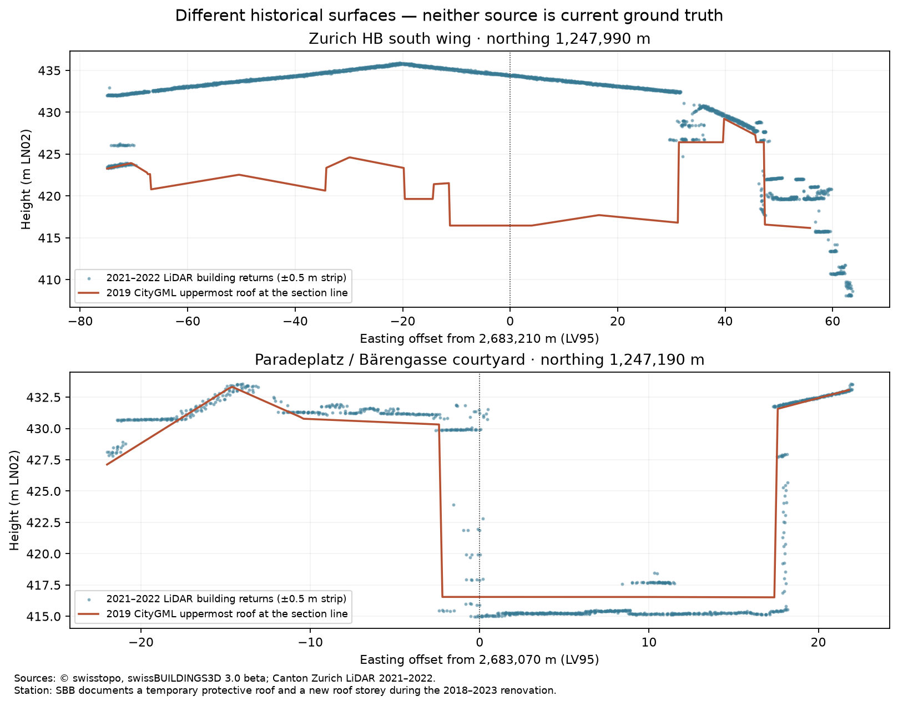

# Zurich shadow evidence review — 30 September 2026

**Decision: HOLD.** Source investigation has progressed, and independently timed photographs have been found. The current model has not passed the [field acceptance criteria](shadow-observations.md). Production geometry, route scoring and coverage remain unchanged.

## Original LiDAR resolves part of the source ambiguity

All **26 previously flagged locations** were inspected against classified returns from **11 official Canton Zurich LAZ tiles**. The files explicitly declare LV95 + LN02 (EPSG:2056 + EPSG:5728). Each location has 54–183 non-withheld building returns within 1 m. Original files, their hashes and local fit/range statistics are recorded in [the LiDAR review](shadow-lidar-review.json); the 411 MB of raw tiles remains outside Git.

This is an independent check of raster processing against original returns, **not another independent survey**: the point cloud and raster come from the same LiDAR product. A plane fitted across multiple surfaces is not a measured roof height. All original flags remain in the record; none were removed to improve a pass rate.

| Location                                                | New evidence                                                                                                                                                                                                                         | Interpretation and remaining work                                                                                                                                                                                                                                                                                                                                                                                                                                                                                                          |
| ------------------------------------------------------- | ------------------------------------------------------------------------------------------------------------------------------------------------------------------------------------------------------------------------------------ | ------------------------------------------------------------------------------------------------------------------------------------------------------------------------------------------------------------------------------------------------------------------------------------------------------------------------------------------------------------------------------------------------------------------------------------------------------------------------------------------------------------------------------------------ |
| Hauptbahnhof south wing, largest discrepancy            | At LV95 `[2683210,1247990]`, 60 building returns span 434.25–434.62 m LN02. The local plane is approximately 434.43 m; the CityGML roof is 416.46 m. Three other station samples also lie on smooth elevated surfaces.               | This is not a tile alignment or height-datum error. [SBB documents a 4,000 m² temporary protective roof and a new roof storey during the 2018–2023 renovation](https://sbb-immobilien.ch/liegenschaften/generalsanierung-zuerich-hb-suedtrakt/). The point-cloud cross-section is consistent with that temporary roof. **This attribution is an inference**, not a surveyed identification of each return. Neither the 2019 surfaces nor construction-era LiDAR establishes the post-renovation roof; current geometry remains unresolved. |
| Paradeplatz / Bärengasse courtyard, `[2683070,1247190]` | 114 building returns within 1 m span **16.95 m** vertically; the single-plane fit has **5.61 m RMSE**. The section shows upper roof/wall returns and a much lower courtyard surface. The map also shows glazed courtyard structures. | The original 8.23 m raster-versus-CityGML difference cannot be interpreted as a single roof-height error. Mixed surfaces/interpolation and possible glass returns require inspection. Do not replace the low surface with the fitted mean or raster value.                                                                                                                                                                                                                                                                                 |
| Brauerstrasse 36 vicinity, `[2682210,1248010]`          | A smooth local plane supports a roughly **6.15 m** difference from the CityGML roof.                                                                                                                                                 | Still open: check original roof geometry and dated building changes. The nearby address is an orientation aid, not proof of building identity.                                                                                                                                                                                                                                                                                                                                                                                             |
| Europaallee 23 vicinity, `[2682650,1248110]`            | A smooth local plane supports a roughly **3.63 m** difference.                                                                                                                                                                       | Still open: verify the exact source building and construction stage. [The developer documents completion of Europaallee in stages through 2020](https://europaallee.ch/ueber-die-europaallee/); that alone does not establish the cause at this point.                                                                                                                                                                                                                                                                                     |
| Other flags                                             | Six of all 26 neighborhoods have plane residuals below 0.03 m; the remaining twenty have residuals of at least 0.38 m. These are descriptive results, not a new exclusion threshold.                                                 | Do not treat nonplanar neighborhoods as single-height ground truth. Retain per-building review, including the fifth station sample. The other 19 buildings beyond the station and Paradeplatz case are not cleared.                                                                                                                                                                                                                                                                                                                        |



Sources: © swisstopo, swissBUILDINGS3D 3.0 beta; Canton Zurich LiDAR 2021–2022, [public tile download](https://maps.zh.ch/download/hoehen/2022/lidar/) and [provider metadata](https://geolion.zh.ch/geodatensatz/4289.html). The LAS creation date and directory modification date are not acquisition timestamps. GPS week time in these LAS files does not, by itself, identify a calendar date.

## Timestamped photographs found and screened

Downloaded and checked **14 public photographic originals** from Wikimedia Commons. Hashes, authors, licences, source URLs, embedded capture clocks and individual exclusion reasons are in the [photo register](validation/photo-register.json). Original EXIF was read from the actual image bytes, independently of the Commons page display. Upload and modification dates were not used as capture dates. The originals remain ignored and are not redistributed with the project.

Three promising ground-shadow candidates remain:

| Photograph                                                                                                                                                  | Embedded GPS capture time                         | Evidence / limitation                                                                                                                                                                                                          |
| ----------------------------------------------------------------------------------------------------------------------------------------------------------- | ------------------------------------------------- | ------------------------------------------------------------------------------------------------------------------------------------------------------------------------------------------------------------------------------ |
| [Münsterhof fountain, Roland Fischer](https://commons.wikimedia.org/wiki/File:M%C3%BCnsterhof_-_Brunnen_DSC_2121_2018-09-05_16-03-02.jpg)                   | **2018-09-05 14:03:51 UTC**, 16:03:51 Zurich time | Clear direct sun and a broad building shadow. Camera clock is 49 s earlier. Permanent fountain provides a location reference; exact ground registration is not yet verified. Current Commons licence: CC BY-SA 4.0.            |
| [Münzplatz / Augustinergasse, Roland Fischer](https://commons.wikimedia.org/wiki/File:Lindenhof_-_M%C3%BCnzplatz_-_Augustinergasse_2011-08-10_12-15-32.jpg) | **2011-08-10 10:16:06 UTC**, 12:16:06 Zurich time | Clear direct sun and building shade; camera is 34 s earlier. Needs ground registration and confirmation that casting roofs were unchanged in 2019. CC BY-SA 3.0.                                                               |
| [Rennweg, Roland Fischer](https://commons.wikimedia.org/wiki/File:Z%C3%BCrich_-_Rennweg_20090311_1.jpg)                                                     | **2010-08-09 13:05:41 UTC**, 15:05:41 Zurich time | Camera/GPS agree; current description also gives 2010-08-09. The obsolete **20090311 filename is not the capture date**. Clear street-shadow edge, but ground registration and historical roofs remain to check. CC BY-SA 3.0. |

Of the other eleven, ten were excluded for missing/conflicting clocks, overcast light, market occlusion or unsuitable receivers. One Limmatquai photograph remains a limited candidate because its principal ground features involve a bridge deck. A GPS clock field is stronger evidence than an assumed local camera time, but it does not prove image authenticity or survey-grade location.

Other investigated sources:

- [SWITCH archive](https://webcam.switch.ch/zuerich/archiv.de.php): retrieved the displayed 2023-04-20 11:00 frame. It is overcast, with insufficient visible street detail; time-zone semantics also remain unverified. Excluded.
- [Official LUBIS single aerial photographs](https://www.swisstopo.admin.ch/de/analoge-luftbilder): queried the official colour collection over Zurich for 2005–2010 and checked all **nine returned metadata files**, from 2007-04-06. Both STAC and CSV have only a date with `00:00:00`, not a verified daylight acquisition time. Do not interpret the placeholder as midnight photography. Single-image orthophotos exist, but these metadata do not yet meet the time criterion.
- Current SWISSIMAGE WMS crops were used to inspect roof context and locate permanent features. Their shadows were **not** used as timed observations. The earlier [SWISSIMAGE RS investigation](shadow-validation.md) remains relevant; no paid order or provider email was sent.

## An exploratory photograph/model disagreement is retained

Before querying the model, two approximate Münsterhof ground points were labelled from the photograph: paving north of the fountain as sunlit, and foreground paving south of it as shaded. The georeferenced mosaic was used only to estimate the fountain's location. The [frozen probe record](validation/photo-probes.json) explicitly excludes both points from formal acceptance because location uncertainty has not been established within 2 m.

| Probe                     | Observed photo class | Model at approximate coordinate         | Sensitivity: 1 m grid inside 3 m radius, at GPS time and ±60 s |
| ------------------------- | -------------------- | --------------------------------------- | -------------------------------------------------------------- |
| North `[2683234,1247171]` | Sun                  | **Shade — disagreement to investigate** | 81 shade / 6 sun / 0 unknown queries                           |
| South `[2683233,1247160]` | Shade                | Shade                                   | 87 shade / 0 sun / 0 unknown queries                           |

The perturbations are **model queries, not 174 observations or confidence probabilities**. They do not measure positional uncertainty. The north probe's first model intersection is a facade about 19.64 m to the southwest at 423.82 m LN02. [Results](validation/photo-probe-results.json) and [caster diagnostic](validation/photo-probe-caster.json) retain the disagreement. Possible causes include registration error, historical geometry and receiver elevation; none has been selected as the explanation. Do not move the point to make it agree or claim a confirmed model defect from an approximate location.

Registration follow-up: the photographed ISSEY MIYAKE storefront is [Münsterhof 12 according to the retailer](https://uk.isseymiyake.com/pages/stores?brand=1), and the yellow Leder Locher facade is Münsterhof 18 in the [City's annotated panorama](https://www.stadt-zuerich.ch/content/dam/web/de/bildung/volksschule/unterricht/gang-dur-zueri/zuerich-waechst-frueher-heute-morgen/d.2.4.-muensterhof-panorama-2016-und-1973-lp.pdf). These identify the background, but do not identify the frozen ground probes within 2 m. The City's [fountain specification](https://www.stadt-zuerich.ch/misc/de/mitteilungsarchiv/medienmitteilungen/2014/10/141029d.html) confirms a 6 m basin, an approximately 1 m smaller basin and a water inlet almost 4 m high. Both basins are approximately waist height: their visible rims cannot be treated as ground-level control points in a planar image transformation. The tentative “north = sun” label is therefore still unverified at that coordinate. No point was relocated after seeing predictions.

Register correction during review: photo-02's original **does** contain GPS time (2011-08-17 12:59:59 UTC, 37 s after the camera clock), contrary to its preliminary exclusion reason. Visual inspection shows an upward view of the station entrance arch with no usable ground-shadow area. Its exclusion is now correctly recorded as unsuitable receiver, with the superseded reason retained in its review history. This correction does not change the candidate count or acceptance denominator.

**Accepted field observations: 0.** Two exploratory points have now been evaluated, but no accuracy percentage or shadow-boundary error can be reported under the predeclared protocol. The original thresholds remain unchanged.

## Next validation work

1. Independently register the three candidate photos using fixed ground features and check historical casting roofs. Resolve the Münsterhof disagreement before using these images for accuracy claims. If registration cannot meet 2 m, retain them as qualitative evidence and use better imagery.
2. Verify current post-renovation station geometry; distinguish permanent roofs from temporary construction covers. Inspect the Brauerstrasse/Europaallee smooth-surface discrepancies and remaining complex roof neighborhoods. Assess street-shadow impact before any data correction.
3. Extend accepted observations across six places, two clear dates and morning/noon/afternoon, including ten independently located boundary checks. These coverage and accuracy requirements have not been relaxed.

## Reproduce this review

```sh
.venv-geo/bin/pip install -r scripts/requirements-validation-review.txt
.venv-geo/bin/python scripts/review-shadow-lidar.py --fetch
.venv-geo/bin/python scripts/test-shadow-lidar-review.py
.venv-geo/bin/python scripts/plot-shadow-roof-review.py
.venv-geo/bin/python scripts/verify-shadow-photos.py --fetch
node --import tsx scripts/check-shadow-photo-probes.ts
```

The roof plot also needs the original CityGML archives from [data preparation](detailed-shade.md), extracting its two buildings on demand. Existing downloads are reused. Photo verification stops if a source changes or the server rate-limits; it does not silently update hashes. LiDAR review needs about 412 MB of downloads and additional RAM for decompression. The optional plotting/image packages are separate from routine application dependencies.

Checks: all **81 TypeScript/model tests**, the **four independent-reference analytical checks**, the **three new LiDAR-review checks**, and original hash/EXIF verification for all **14 photographs** pass locally. The earlier [GitHub check run](https://github.com/gumbrich/cooler-walks/actions/runs/36728743349) is now successful, including all four browser shards: a Chromium installation had stalled, and the cancelled shard passed on retry. The workflow now bounds future Chromium installation at ten minutes. These software checks do not establish field accuracy.
