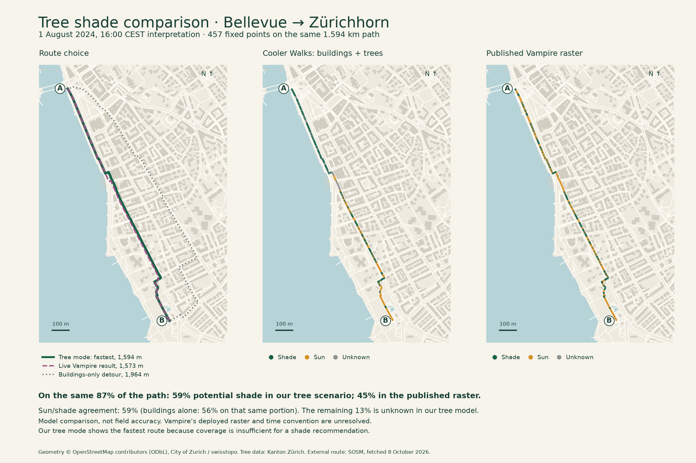

# Bellevue–Zürichhorn: tree shade and Vampire Routing

Compared **8 October 2026**, Cooler Walks **0.16.0**, source `587b22c`. Adding trees reduces the difference in the total estimated shade, but **the models still disagree substantially about where shade falls**. Nothing here establishes field accuracy or clears the existing validation hold. No production model or threshold was changed.

## The route and time

The pair is the lakeshore walk fixed before the [original five-pair comparison](shade-service-comparison.md): Bellevue `[8.5443354, 47.3668209]` → Zürichhorn `[8.5520945, 47.3543016]`, WGS84 longitude/latitude. Both endpoints are in the tree pilot. Water and traffic preferences and municipal-pavement mode are off; Cooler allows five extra minutes.

The [SOSM demo](https://sosm.ch/de/die-coolste-art-schattige-wege-zu-finden-vampir-routing-auf-routing-osm-ch/) uses 1 August at 16:00. Its author's [presentation](https://geobeer.ch/slides/46/lightning-talks.pdf) gives 2024. The primary comparison interprets this as **1 August 2024, 16:00 CEST**, or 14:00 UTC. Whether the published raster instead uses local solar time remains unresolved; the alternative interpretation is retained below. Neither result is selected to improve agreement.

Two fresh live requests returned the following first routes. Their geometries are unchanged from 7 October; no endpoint geocoding was used. SOSM reports zero endpoint snapping distance, and Cooler retains its original nearby graph nodes.

| Planner result             |    Distance | Reason for showing it                                                |
| -------------------------- | ----------: | -------------------------------------------------------------------- |
| Cooler, tree pilot enabled | **1,594 m** | Fastest route; insufficient tree coverage for a shade recommendation |
| Live Vampire               | **1,573 m** | First returned Vampire route                                         |
| SOSM ordinary foot         |     1,607 m | First ordinary walking result                                        |
| Cooler, buildings only     |     1,964 m | Qualifying building-shade alternative, +4.6 minutes                  |

Our tree-mode walk and Vampire use the lakeshore corridor but are not identical: about 71% of our path lies within 8 m of theirs. Their 21 m length difference is not evidence of identical geometry. **The disappearance of our inland detour is a coverage fallback, not proof that tree routing now agrees with Vampire's optimisation.** Tree mode has 87.7% native arrival-time coverage, below the unchanged 95% recommendation threshold. It therefore shows the fastest walk and a partial estimate. The internal fallback mode is named `greenery`, but no greener alternative is returned or presented as a shade recommendation.

The live Vampire response includes geometry, distance and duration, **not a shade percentage** or raster build identifier. Duration is not sunlight exposure; the services also use different speed/cost conventions. [Saved live responses](validation/tree-shade-comparison/external-routes.json).

## Detour-budget comparison

Follow-up on 8 October: recalculated **all three public extra-time settings**, using exactly the same endpoints, 16:00 CEST departure and the same saved Vampire response. The selection matches the app's default: alternative when offered, otherwise fastest. Both tree-enabled and buildings-only results are retained.

The current [Vampire interface](https://routing.osm.ch/) exposes no maximum extra-walking-time control after selecting `Foot (vampire)`. [Observed controls](validation/tree-shade-comparison/vampire-controls.json). Its [published profile](https://github.com/sosm/cbf-routing-profiles/blob/6b45390967718a4b785af11222fd0dc2688eeeac/foot-vampire.lua) instead uses a fixed radiation penalty; the exact deployed profile remains unidentified. Our 0/5/10-minute setting is a hard ceiling relative to our own fastest route, not a request to use up those minutes. Vampire's fixed 1,573 m result is therefore held constant across the comparisons.

| Tree pilot | Allowed extra time | Selected distance | Extra time actually used | Our path within 8 m of Vampire | Our path within 20 m of Vampire |
| ---------- | -----------------: | ----------------: | -----------------------: | -----------------------------: | ------------------------------: |
| On         |              0 min |           1,594 m |                    0 min |                          71.3% |                           97.7% |
| On         |              5 min |           1,594 m |                    0 min |                          71.3% |                           97.7% |
| On         |             10 min |           1,594 m |                    0 min |                          71.3% |                           97.7% |
| Off        |              0 min |           1,594 m |                    0 min |                          71.3% |                           97.7% |
| Off        |              5 min |           1,964 m |                  4.6 min |                           1.2% |                            2.4% |
| Off        |             10 min |           1,964 m |                  4.6 min |                           1.2% |                            2.4% |

**With trees on, the routes follow almost the same corridor at every budget.** Our path's mean nearest distance from Vampire is 4.2 m; 95% of it is within 9.4 m. The lower 71% figure from the earlier strict 8 m comparison should not be read as 29% of the walk taking a completely different street. The exact polylines differ, and proximity alone cannot establish identical pavements, crossings or legal connections.

Tree mode returns byte-identical coordinates at all three budgets because its fastest route has only 87.7% model coverage. More allowed time does not override the 95% coverage requirement, so **no tree-shade alternative is recommended**. This is the reason the budget does not change this particular result.

**With trees off, allowing a detour produces a substantially different inland route.** Both 5 and 10 minutes select the same 1,964 m route (+4.63 minutes). Its mean nearest distance from Vampire is 179 m; only 2.4% lies within 20 m of Vampire. No better qualifying option is found among the six evaluated candidates when the limit rises to ten minutes; this does not establish a globally optimal path or prove that no other useful route exists.

The distance fractions use LV95 metric polyline intersection with 8 m and 20 m buffers. [Full metrics](validation/tree-shade-comparison/detour-comparison.json) retain both directions, sensitivity at 3/8/15/20/30/50 m and uniformly weighted nearest-distance samples at no more than 2 m spacing. [Computed routes](validation/tree-shade-comparison/detour-routes.json) preserve coordinates, actual time used, coverage, selection reason and source hashes. All time limits, unchanged fastest geometry, original five-minute outputs and identical-coordinate claims are checked; metric sanity checks and TypeScript compilation pass. No app algorithm, control or threshold changed.

```sh
node --import tsx scripts/export-vampire-detours.ts
.venv-geo/bin/python scripts/compare-vampire-detours.py
```

The route-choice map below already shows both outcomes: solid green for the shared 0/5/10-minute tree-mode result and dotted grey for the buildings-only 5/10-minute detour, against dashed purple Vampire.

## Shade at the same points

We reused all **457 original midpoints**, spaced at most 4 m along the exact same 1,594 m Cooler fastest path. Building predictions at these points are unchanged from the previous benchmark. Both Cooler variants use the same departure instant for this comparison. This isolates the effect of trees from route choice and from the app's arrival-time sampling.

Vampire values below are **our samples of its author's pinned public raster**, using the published `<100` shade proxy. They are not percentages returned by the live service, whose deployed raster remains unidentified. [Pinned artifact](https://github.com/sosm/cbf-routing-profiles/tree/6b45390967718a4b785af11222fd0dc2688eeeac/vampire).

All three columns use the **same 1,382 m of mutually known path**, or **86.7% of the route**. The other 212 m remain unknown in the tree model. Excluding those metres from the building baseline too prevents missing tree data from falsely improving the comparison.

| Same known path, 16:00 CEST snapshot | Buildings only | Buildings + tree scenario | Published Vampire raster |
| ------------------------------------ | -------------: | ------------------------: | -----------------------: |
| Estimated/potential shade            |       **2.3%** |                 **58.9%** |                **45.0%** |
| Sun/shade agreement with the raster  |      **56.0%** |                 **58.6%** | Reference for comparison |

Trees reduce the total-shade gap from **42.6 to 13.9 percentage points**, but improve location-by-location agreement by only **2.6 percentage points**. They create 409 m of new agreement and 373 m of new disagreement. In the final tree comparison, 383 m are shade in Cooler but sun in the raster; another 190 m are sun in Cooler but shade in the raster. Agreement is weighted by walking distance, not an unweighted count of samples, and is not an accuracy score.

The earlier report's **42% raster shade** used the whole path. Here it is **45% on the smaller, shared known portion**. The raster and threshold did not change. Likewise, comparing the old whole-path agreement of 58.7% directly with the new 58.6% would mix denominators; the fair baseline on today's shared portion is 56.0%.



The two shade maps show the full fixed path, including our unknown sections. The figures beneath them use the shared known portion. [Download the figure](validation/tree-shade-comparison/lakeshore-comparison.pdf).

## Timing and the estimate shown in the app

Under the unresolved **16:00 local-solar-time interpretation** (the existing independent reference of approximately 15:32:09.700 UTC), the tree scenario gives 66.5% shade versus 46.5% in the raster, with 63.4% agreement and 80.9% comparable coverage. Buildings alone give 60.5% agreement on those same points. This remains a modest agreement gain; the apparently higher figure cannot identify the correct clock.

The actual app advances time as someone walks, using its original up-to-8 m samples. For a **16:00 CEST departure**, the 20-minute fastest walk shows **59% potential shade over 88% model coverage**: about 60 m building shade, 766 m additional potential tree shade, 573 m sun and 195 m unknown. These arrival-time figures are close to the snapshot by coincidence; they use different points and times and must not be substituted into the raster comparison. [Production-router outputs and fixed samples](validation/tree-shade-comparison/cooler-routes.json).

## What to validate next

This comparison supports keeping tree shade experimental. The opaque vegetation envelope from predominantly leaf-off LiDAR may miss summer crowns and also overstate opacity; Vampire's surface raster has different source/receiver assumptions and unresolved clock metadata. Neither is ground truth. The remaining differences cannot yet be attributed to one cause.

Two useful field-check locations are approximately `[8.544420, 47.366731]` near the Bellevue end (Cooler tree shade, raster sun) and `[8.551200, 47.356145]` toward Zürichhorn (Cooler sun, raster shade). The saved report includes the eight longest disagreement stretches with coordinates and distance along the walk. Record date, time, cloud/leaf state and actual pavement position. An autumn observation cannot directly validate this August foliage scenario; recompute our model at the observation time and keep the fixed Vampire raster comparison separate.

## Checks and reproduction

The export checks exact preservation of the original points, unchanged building classifications at both clock interpretations, real-route distance accounting and detour limits. The comparison verifies source/raster hashes, raw-response hashes when cached, endpoint geometry, separate unknowns, equal denominators and the agreement-change arithmetic. TypeScript compilation passes. The figure uses actual source geometry and saved outputs; it was visually inspected. No application code or historical comparison evidence is overwritten.

```sh
# Production model, using the original fixed points:
node --import tsx scripts/export-tree-shade-comparison.ts
# Same-path comparison; requires the pinned raster cached as documented
# in shade-service-comparison.md:
.venv-geo/bin/python scripts/compare-tree-shade-services.py
# Optional figure; matplotlib 3.11.2 was used:
MPLCONFIGDIR=/tmp/cooler-mpl .venv-geo/bin/python scripts/plot-tree-shade-comparison.py
# Optional two-request refresh of the live service, changing dated evidence:
.venv-geo/bin/python scripts/fetch-tree-shade-comparison.py
```

[Full metrics](validation/tree-shade-comparison/comparison.json) · [All point classifications](validation/tree-shade-comparison/point-comparisons.json) · [Tree model and limits](tree-shade-pilot.md). Route geometry © OpenStreetMap contributors (ODbL); external service SOSM; canopy data Kanton Zürich. Other source attribution is retained in the figure and [data register](data-sources.md).
